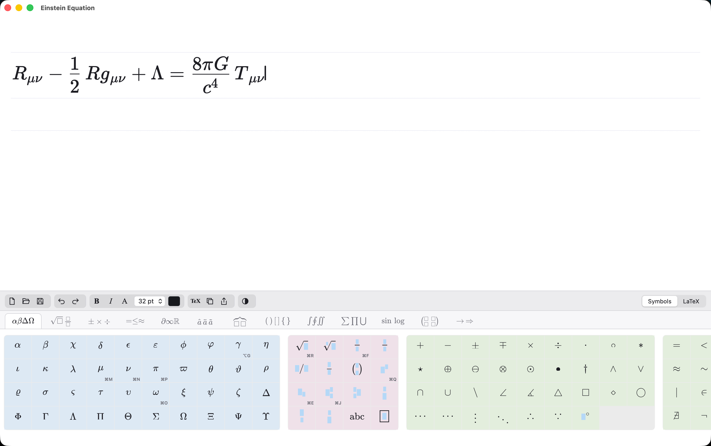
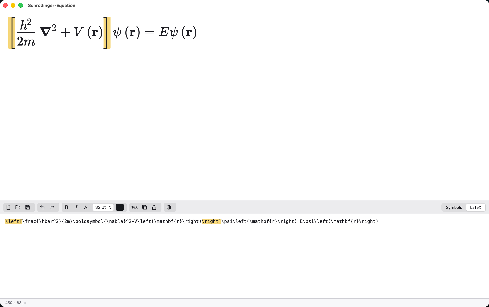

# Visual Typist

Visual Typist is a visual LaTeX equation editor for macOS on Apple Silicon. You type math in a WYSIWYG canvas, with structures, slots and keyboard shortcuts like a classic equation editor, and the LaTeX code is always one keystroke away. It was inspired by earlier editors such as [MathType](https://www.wiris.com/en/mathtype/), [AxMath](https://www.axsoft.co/) and [VisualTeX](https://github.com/paulhe666/visualtex).

**Try it right away in your browser: [Visual-Typist](https://haixuan-lin.github.io/Visual-Typist/)** --- or [build the Mac app](#install) with one command.



Flip the bottom pane from the symbol palette to the LaTeX code at any time; the two stay in sync, and matching brackets are highlighted in both.



## Install

You need an Apple Silicon Mac with macOS 14 or later. In a terminal:

```sh
./build.sh
./install.sh
```

`build.sh` examines the build environment and repairs what it can before compiling. It asks before anything that needs your password or a download. `install.sh` then copies the app into `/Applications` and opens it.

The app is signed ad hoc for local use; it is not notarized.

## Matrices

In **Matrices & Arrays**, choose the **m × n** tile to insert a custom matrix with
1–20 rows and columns and any of the six bracket styles. Tab and Shift-Tab move
between cells. Existing fixed-size templates are still available. When copying a
matrix wider than ten columns into another document, add
\setcounter{MaxMatrixCols}{20} after loading amsmath; the Mac app's standalone
LaTeX export includes this setting.

## Wick contractions

The **Quantum Field Theory** palette inserts editable Wick pairs and crossed
pairs. Type into each endpoint and use Tab to move to the next one. Both package
syntaxes work in the canvas and in SVG/PNG/MathML exports:

- simpler-wick: \wick{\c1 A\c2 B\c1 C\c2 D}, labels 1–9,
  the shorthand \c, and local sep/offset lengths.
- simplewick: \contraction, \acontraction, \bcontraction, with an optional
  height and four arguments (prefix, left endpoint, middle, right endpoint).
  These draw only the line; write the expression after them. The palette uses
  \acontracted and \bcontracted, which also include the expression.

LaTeX file exports include the required packages. Copied equation snippets need
\usepackage{simplewick} or \usepackage{simpler-wick} in the destination preamble.
The browser supports local lengths in em, ex, pt, mu, mm, cm and in; it does not
interpret arbitrary TeX register expressions or global TikZ/package configuration.

Run node scripts/test-wick.cjs for syntax checks. Tests/Fixtures/wick.tex exercises
the corresponding real LaTeX packages (compile twice for TikZ positioning).
