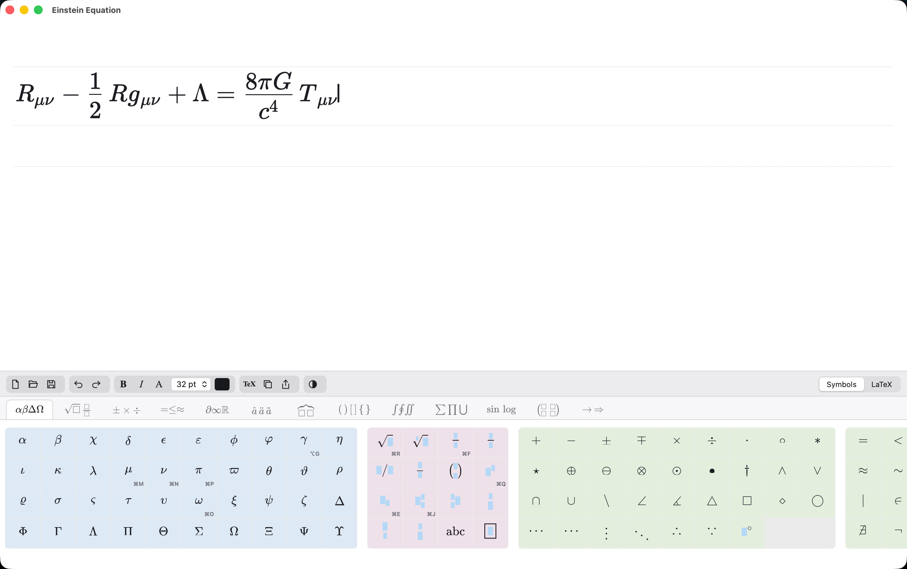
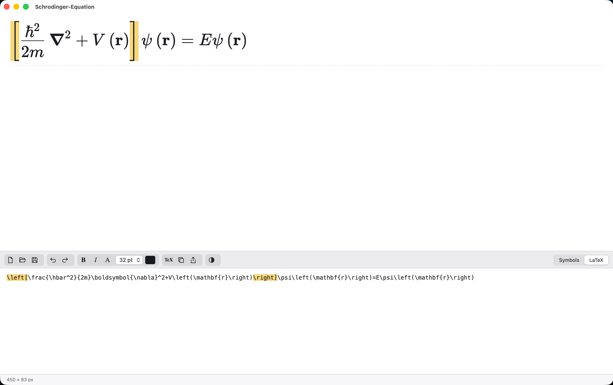

# Visual Typist

Visual Typist is a visual LaTeX equation editor for macOS on Apple Silicon. You type math in a WYSIWYG canvas, with structures, slots and keyboard shortcuts like a classic equation editor, and the LaTeX code is always one keystroke away. It was inspired by earlier editors such as [MathType](https://www.wiris.com/en/mathtype/), [AxMath](https://www.axsoft.co/) and [VisualTeX](https://github.com/paulhe666/visualtex).

**Try it right away in your browser: [Visual-Typist](https://haixuan-lin.github.io/Visual-Typist/)** --- or [build the Mac app](#install) with one command.



Flip the bottom pane from the symbol palette to the LaTeX code at any time; the two stay in sync, and matching brackets are highlighted in both.



## Install

You need an Apple Silicon Mac with macOS 14 or later. In a terminal:

```sh
./build.sh
./install.sh
```

`build.sh` examines the build environment and repairs what it can before compiling. It asks before anything that needs your password or a download. `install.sh` then copies the app into `/Applications` and opens it.

The app is signed ad hoc for local use; it is not notarized.
